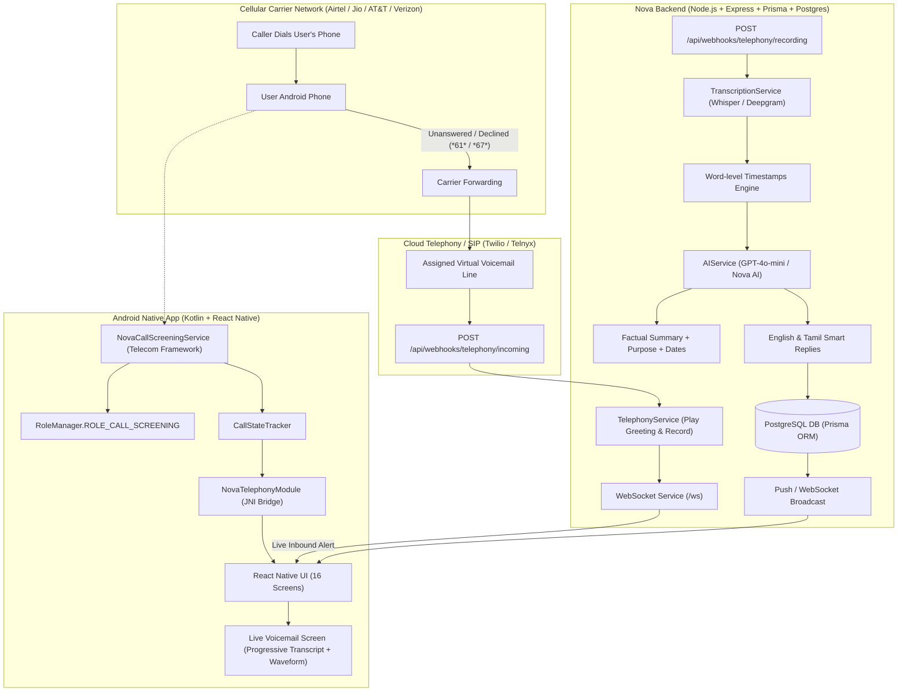

# Nova Live Voicemail - System Architecture

## Architectural Decoupling & Security Boundaries

### 1. Cellular Call Audio vs Local App Sandboxing
- Android's security architecture prevents non-system third-party applications from reading cellular telephone call audio directly via local microphone APIs.
- Nova follows strict standard platform specifications:
  - **Incoming Call Detection**: Handled by Android's `CallScreeningService` within system timeouts (~5 seconds).
  - **Audio Recording**: Handled by carrier-level conditional call forwarding (`*61*`, `*67*`, `*62*`) to an authorized cloud telephony gateway (Twilio / Telnyx / FreeSWITCH).
  - **Live Voicemail Feed**: The cloud telephony service streams audio or transcription events in real-time over secure WebSockets (`/ws`) directly to the mobile application.

### 2. Zero-Hallucination AI Architecture
- Voicemail summaries are generated using a factual prompt architecture:
  - Strict prohibition against inventing dates, names, or phone numbers.
  - Generates bidirectional smart replies in both English and Tamil/Tanglish.
  - Word-level timestamps enable synchronized visual transcript highlighting during playback.
